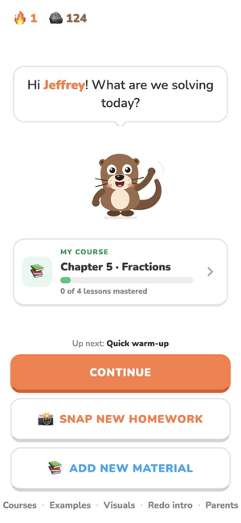
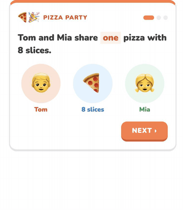
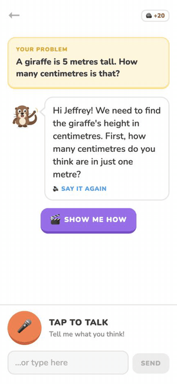
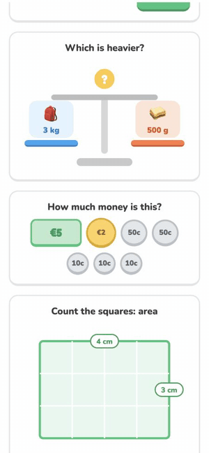
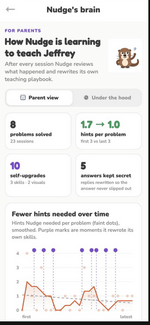
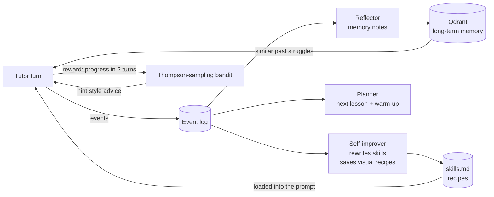
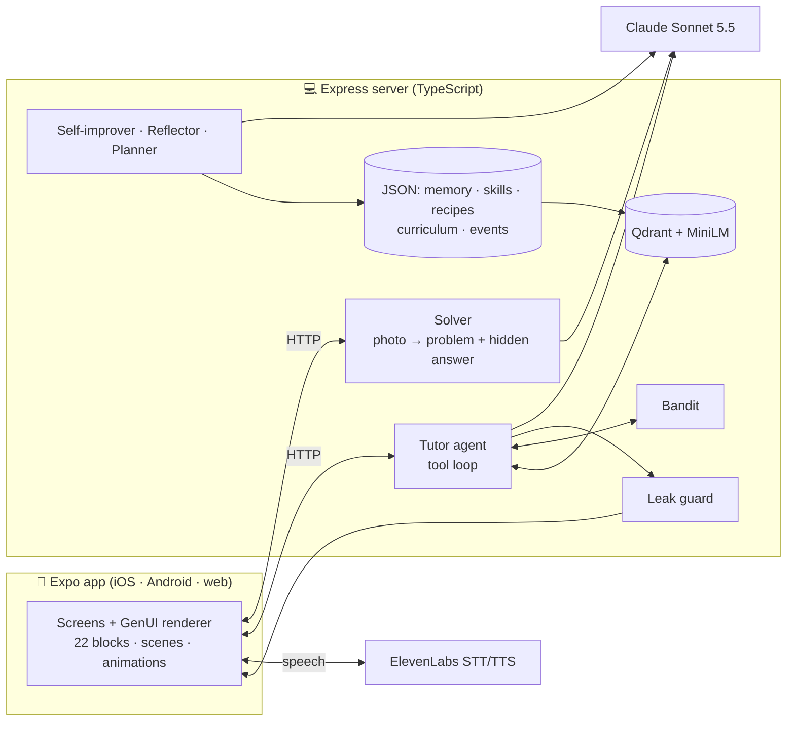

<div align="center">


# Nudge

**The homework buddy that never gives the answer, and gets better at teaching your kid every session.**

A voice-first, self-improving AI math tutor for primary-school kids (6–10).<br/>
It reads the homework, refuses to just solve it, draws exactly the picture the child needs,<br/>
and after every session rewrites its own teaching playbook for that one child.


</div>

<table>
  <tr>
    <td align="center" width="33%"><br/><sub><b>Snap homework, continue a lesson, or add a textbook chapter</b></sub></td>
    <td align="center" width="33%"><br/><sub><b>Claude designs an animated, step-by-step explanation</b></sub></td>
    <td align="center" width="33%"><br/><sub><b>The child finds the answer and gets the celebration</b></sub></td>
  </tr>
</table>

---

## The problem

> *Kid opens ChatGPT. "What's 3/8 + 2/8?" Gets "5/8". Copies it. Done.*
> *"Ok, and 3/7 + 2/7?" Kid reaches for the phone again.*

Every AI homework tool optimises for **getting the homework done**. The answer is always one photo away, so the
worksheet is finished and nothing is learned. Nudge is built the other way round:

- 🔒 **It never gives the answer.** The answer is solved on the server and never sent to the phone. Every reply,
  every picture and every agent trace passes a leak guard.
- 🎨 **It shows instead of tells.** Claude composes an animated explanation from 22 visual building blocks,
  in the app's own style.
- 🧠 **It improves itself.** After every session the agent rewrites its own teaching skills for *this* child,
  saves the visuals that worked and remembers mistakes by meaning, across days.

---

## How a session feels

| | |
|---|---|
| 📸 **Snap** | The child photographs one problem (or picks an example, or continues a textbook lesson). Claude reads it, solves it privately and checks the maths with `mathjs`. |
| 🦦 **Talk** | The otter retells the story in kid words and asks one small question. Push-to-talk or type; voice in and out via ElevenLabs. |
| 🪜 **Hints, not answers** | Wrong answer or "I don't know" moves one step up a hint ladder (question → concept → visual → simpler twin → first step). "Just tell me!" gets a kind no and a better hint. |
| 🎬 **Show me how** | While the intro plays, the agent prepares a 2–3 step animated scene for this exact problem. One tap plays it. |
| 👀 **Attention** | Words appear as they're spoken, the otter reacts, and if the child drifts off for 20 s it pops up with a nudge. |
| 🎉 **Reward** | A correct step gets a burst of stars; the solved problem gets the dancing otter and confetti. |

---

## Generative UI: Claude draws the explanation



Claude doesn't pick from a few canned widgets. For every hint it **composes a scene**: a short animated sequence
of steps, each with one spoken sentence and a visual block. It also makes the design calls:

- **22 blocks:** `FractionPie` `FractionBars` `Counters` (rows of ten, cross-outs) `ArrayGrid` `BarChart`
  `BarModel` `NumberLine` `PlaceValue` `Ruler` `UnitLadder` `Clock` `Equation` (stacked fractions, `?` box)
  `Compare` `Choice` `Slider` `Callout` `Picture` `Steps` `Balance` `Money` `Shape` `Tally`
- **Design choices:** a `theme` colour that fits the story, header `art` emoji, `**highlighted**` key words,
  `layout: "row"` to put two visuals side by side, and `focus` for a pulsing "look here" ring
- **One visual language:** Claude decides *what* to show and the app decides *how* it looks, so every scene
  uses the same colours, rounded font and chunky shapes. No black outlines, nothing off-brand.
- **Safe:** every scene is validated with `zod` (bad blocks are dropped, not crashed on) and checked by the leak
  guard: no shaded result, no counted result, no `= 5/8`.

```jsonc
{ "type": "Scene", "title": "Pizza party", "theme": "orange", "art": "🍕🎉",
  "steps": [
    { "say": "Tom and Mia share **one** pizza with 8 slices.", "blocks": [{ "type": "Picture", "items": [ … ] }] },
    { "say": "Tom eats **3** slices, Mia eats **2**.", "layout": "row",
      "blocks": [{ "type": "FractionPie", "pies": [{ "parts": 8, "shaded": 3 }] }, { "type": "FractionPie", "pies": [{ "parts": 8, "shaded": 2 }] }] },
    { "say": "How many **eighths** together?", "blocks": [{ "type": "Equation", "lines": ["3/8 + 2/8 = ?"], "focus": true }] }
  ] }
```

<br clear="right"/>

---

## The self-improving agent



The core of Nudge is a tutor that **learns how to teach one specific child** and shows its work.



1. **Skills it writes for itself.** After a session the agent reads the log (what it tried, what the child said,
   what helped) and writes or rewrites short teaching playbooks: *"Start with a picture before numbers. When he
   says 'I'm stupid', praise the step, not the answer."* They're versioned (v1 → v5) and loaded into the tutor's
   prompt before every future session.
2. **Visual recipes.** Scenes that led to progress are saved and reused on similar problems.
3. **Strategy that learns.** A Thompson-sampling bandit per topic keeps a `Beta(α, β)` belief for each hint style
   (talking, pictures, stories, smaller numbers). The agent can override it, but only with a logged reason.
4. **Memory by meaning.** Notes and every past struggle are embedded into a local **Qdrant**. Before each hint the
   tutor sees the most similar earlier moments and what helped then.
5. **A plan for tomorrow.** The planner marks lessons for review and writes a warm-up aimed at the mistake that
   keeps coming back.

**The kid never sees any of this.** It lives behind a **Parents** link, in *Nudge's brain*:

- **👪 Parent view:** hints per problem going down over time (with a marker wherever the agent rewrote itself),
  every self-upgrade with its reason and a before/after diff, what helps this child, and what it knows about them.
- **⚙️ Under the hood:** live models and latency, an animated pipeline with live counts, the bandit's belief curves,
  real agent traces (`recall → strategy → check → speak`), the raw skill files, the event log, and a box to query
  the long-term memory yourself.

<br clear="right"/>

---

## Never gives the answer

The agent decides, the code guards the edges:

- The **hidden answer stays on the server**. The phone never receives it.
- A **leak guard** checks every spoken reply, every visual (shaded fractions, counted objects, bar values,
  number-line marks, coins…) and every trace step: in digits, words, fractions, decimals and with units. On a
  leak the reply is regenerated, and if it leaks again a safe fallback question is used.
- Answers are **verified with `mathjs`** before a problem is used.
- Parent-facing traces pass the same guard.

---

## Long-term memory (Qdrant)

Keyword recall only finds a note when the words match. The vector memory finds it by **meaning**, across days:
today's *"he added the bottom numbers"* matches the note *"Adds denominators"* with no word in common.

| Collection | One point per | Used for |
|---|---|---|
| `nudge_notes` | memory note | `recall_memory` by meaning; `write_memory` confirms an existing note instead of adding a near-duplicate |
| `nudge_attempts` | moment the child struggled (problem, lesson skill, what they said, how long, whether the next hint helped) | similar past struggles before every hint, picking the next practice problem, the planner's "keeps coming back" signal |

- **No Docker, no embedding API.** On first start the server downloads the official Qdrant binary (pinned,
  sha256-verified) and `all-MiniLM-L6-v2`, runs Qdrant on `127.0.0.1` and embeds in-process with WebAssembly.
  Text never leaves the laptop.
- **Never in the way.** Live tutor turns wait at most 400 ms for memory. If Qdrant is missing or slow, everything
  falls back to keyword recall. The JSON files stay the source of truth, and the index re-syncs on every start.
- `npm run vector:setup` fetches everything ahead of time (bad wifi at the venue). `MEMORY_BACKEND=json` turns it
  off, and `QDRANT_URL` (+ `QDRANT_API_KEY`) points at an existing Qdrant instead.

---

## Textbook mode

A parent or teacher uploads the chapter the class is working on (PDF or photo). An agent turns it into 3–5 short
lessons with worked examples and verified practice problems, **taught the same way the textbook does**. The tutor
grounds its hints in that method, the next practice problem is the one closest to past struggles, and after each
session the planner re-plans what comes next.

---

## Architecture



| Agent | When | Does |
|---|---|---|
| **Solver** | photo / example / lesson problem | reads the problem, solves it privately, verifies with `mathjs`, writes the intro |
| **Scene designer** | every new problem (background) | prepares the "Show me how" scene |
| **Tutor** | every child turn | tool loop: `recall_memory` · `get_strategy_advice` · `show_component` · `check_answer` · `check_step` · `write_memory` · `speak` |
| **Reflector** | session end | turns the session log into memory notes |
| **Self-improver** | session end | rewrites its own skills, saves visual recipes |
| **Planner** | session end | lesson mastery, next lesson, a warm-up aimed at the recurring mistake |
| **Curriculum builder** | textbook uploaded | read → plan → write lessons → generate + verify problems |

---

## Run it

**1. Keys** in `server/.env` (never commit). Without `ANTHROPIC_API_KEY` the server runs in mock mode.

```
ANTHROPIC_API_KEY=...
ELEVENLABS_API_KEY=...
ELEVENLABS_VOICE_ID=...
```

**2. Server**

```bash
cd server && npm install && npm run vector:setup && npm run dev
```

**3. App**

```bash
cd mobile && npm install && npx expo start
```

Press `w` for the browser, `i` for the iOS simulator, or scan the QR code with Expo Go. On a phone, set
`EXPO_PUBLIC_API_URL=http://<laptop-LAN-IP>:8787` in `mobile/.env`.

Sample inputs: `samples/textbook-fractions.pdf`, `samples/*.png`. Try the **Visuals** link on the home screen
to see every block.

<details>
<summary><b>API</b></summary>

| Endpoint | Does |
|---|---|
| `POST /session/start` · `POST /session/end` | session; end runs reflector + self-improver + planner in parallel |
| `POST /problem` | photo or example text → problem (answer kept server-side) + intro |
| `GET /problem/:id/scene` | the "Show me how" scene, prepared ahead of time |
| `POST /turn` | tutor turn (audio, text or UI event) → reply + visual + trace |
| `POST /tts` | speak a scene step in the tutor's voice |
| `POST /textbook` → `GET /textbook/job/:id` | build a curriculum from a chapter, with a live trace |
| `GET /curriculum` · `POST /lesson/problem` | lessons, warm-up, next practice problem |
| `GET /profile` · `POST /profile` | onboarding profile (name, grade, interests) |
| `GET /brain` | skills, visual recipes, changelog |
| `GET /insights` · `GET /system` | numbers for the parent dashboard and "Under the hood" |
| `GET /progress` · `GET /learned` | pebbles/streak, bandit, memory |
| `GET /vector/status` · `GET /vector/search` · `POST /vector/reindex` | long-term memory |

Contract: [`shared/contract.ts`](shared/contract.ts), copied byte-identical into `server/src` and `mobile/src`.

</details>

<details>
<summary><b>Repo layout</b></summary>

```
mobile/                 Expo app
  src/screens/          Home, Talk, Pick, Lessons, Result, Onboarding, Nudge's brain …
  src/genui/            GenUI renderer + 22 blocks (scene player, themes, focus ring)
  src/charts.tsx        parent dashboard charts
  src/tech.tsx          "Under the hood" view
  assets/otter/         the mascot's moods (GIFs)
server/src/
  tutor.ts              tutor agent loop + hint ladder + leak-guarded replies
  brain.ts              self-improver, visual recipes, prepared scenes
  guard.ts              answer-leak guard (text + every visual block)
  uispec.ts             zod schema + the GenUI docs Claude reads
  vector/               Qdrant process, embeddings, semantic recall
  planner.ts · curriculum.ts · insights.ts · system.ts
shared/contract.ts      API contract
```

</details>

---

## 3-minute demo

1. **The problem:** Kevin asks ChatGPT, copies "5/8", then can't do 3/7 + 2/7.
2. **Snap** the same worksheet → the otter retells it and asks one small question.
3. **"Just tell me"** → refused kindly. A wrong answer → the agent draws two pizzas side by side.
4. **Solve** → the dancing otter.
5. **Parents → Nudge's brain** → the skill it just rewrote about Kevin, the hints-per-problem line going down,
   and *Under the hood*: the agent trace and the memory search, live.

<div align="center">
<br/>

<br/>
<sub>Built in a hackathon. Hints, not answers.</sub>
</div>
